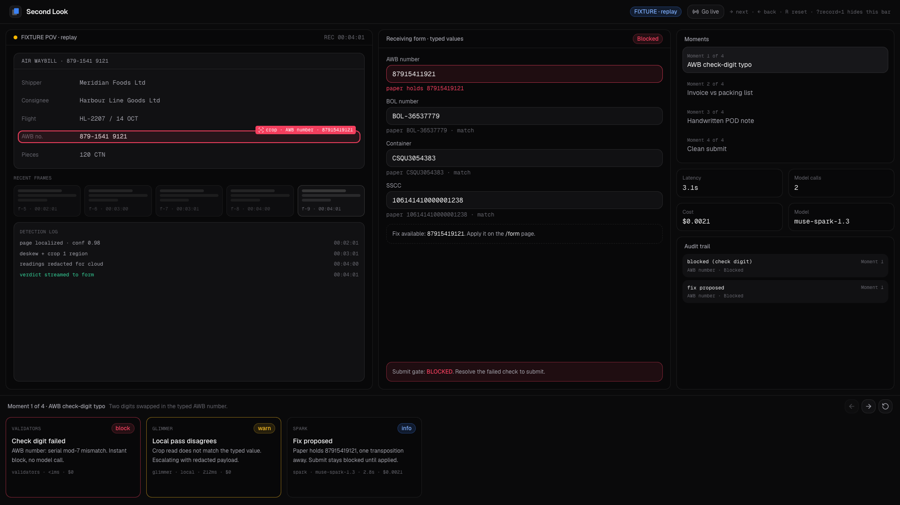
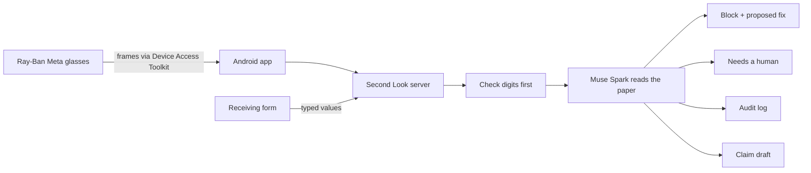

# Second Look

The co-signer that reads the paperwork before you sign.

In 2020 Citibank wired $900M to Revlon's lenders by mistake. The screen
looked right. Nobody read it twice. Second Look puts Ray-Ban Meta
glasses on a warehouse receiving desk: the glasses read the paper while
the app watches what the worker types, and when the two disagree it
blocks the submit and proposes the value on the paper as the fix. It
works in both directions, paper first or typing first.



Demo video: [watch the 3-minute demo on Vimeo](https://vimeo.com/1242879630)

## How it works



- Typed values stream from the receiving form; camera frames stream
  from the glasses through the Android app.
- Check digits run before any model call (AWB mod-7, ISO 6346
  container, SSCC mod-10). A bad digit blocks instantly and for free.
- Muse Spark reads the document image and compares it with the form:
  references, carrier, consignee, counts, cross-document gaps (invoice
  vs packing list, BOL vs AWB), and the delivery-receipt signature.
- A mismatch blocks the submit with the paper value as the fix.
  Formatting differences (case, punctuation, Inc or LLC) do not flag.
- An unreadable or covered field goes to "needs a human", never a
  silent pass.
- Every decision lands in an append-only audit log; a handwritten POD
  note such as "2 cartons damaged" becomes a claim draft.

## Meta stack

- Muse Spark (`muse-spark-1.3`) via the Meta Model API: reads the
  paper, explains the mismatch, proposes the fix.
- SAM 3.1 behind the `SamAdapter` interface: parked after empty-text
  replies for document concepts; Spark JSON boxes cover crops today.
- Muse Glimmer local tier with PII redaction before anything reaches
  the cloud: stubbed until weights land, labelled `(stub)` in the UI.
- Ray-Ban Meta glasses via the Wearables Device Access Toolkit on
  Android (`apps/android`).
- Built with Muse Code.

## Results

Synthetic corpora: a 100-form standard split and a 40-form hard split
(near-miss check digits, cross-document gaps, blur, glare, skew).

| arm | split | flagged | precision | recall | avg latency | cost |
| --- | --- | ---: | ---: | ---: | ---: | ---: |
| check-digit-only | std 100 | 48 | 100.0% | 60.0% | <1ms | $0.0000 |
| tiered-real | std 100 | 79 | 100.0% | 98.8% | 3117.7ms | † |
| check-digit-only | hard 40 | 13 | 100.0% | 39.4% | <1ms | $0.0000 |
| single-model-real | hard 40 | 33 | 100.0% | 100.0% | 1848.5ms | $0.0855 |
| vision-real | hard 40 | 33 | 100.0% | 100.0% | 3085.7ms | $0.6169 |

† ~$0.46 combined upper bound for both standard real arms (per-arm
split unrecorded).

Tiered checks cost roughly $0.003 per text form. End-to-end checks
land under 5 seconds live
(3.4s block with fix, 4.9s warn with escalation). The fake-video end-to-end matrix passes 45/45 scenarios
with live models, in both directions. Full tables: docs/EVAL.md.

## Run it

Requires Node 22 and pnpm; ffmpeg for the clip and fake-video paths.

```sh
pnpm install
cp .env.example .env                  # add your Meta Model API key as MODEL_API_KEY; never commit .env
pnpm --filter @second-look/web dev    # http://localhost:3000/demo, /form, /dashboard
```

Without a key, deterministic stubs serve every model call. Live models:

```sh
SECOND_LOOK_MODELS=real pnpm demo:lan   # server on 0.0.0.0:3100 for the phone
pnpm test:fake-video                    # both-direction matrix against that server
```

Tests and the submission gate:

```sh
pnpm test
pnpm -r typecheck
pnpm check:submit
```

Every env var the code reads is in `.env.example`: `MODEL_API_KEY`,
`META_API_KEY`, `MODEL_API_BASE_URL`, `SECOND_LOOK_MODELS`,
`SECOND_LOOK_CALL_BUDGET`, `AUDIT_DIR`, `FFMPEG_BIN`, `PORT`,
`VERDICT_DELAY_MS`, `SHOTS_BASE`, `SHOTS_CHROME`.

## More detail

- [docs/DEMO.md](docs/DEMO.md): demo script and backup replay
- [docs/TEST-PLAN.md](docs/TEST-PLAN.md): fake-video test plan and results
- [docs/ANDROID.md](docs/ANDROID.md): glasses and phone setup
- [docs/EVAL.md](docs/EVAL.md): full eval tables and clip path
- [docs/ARCHITECTURE.md](docs/ARCHITECTURE.md): packages, env vars, real vs stubbed
- [STATUS.md](STATUS.md): per-batch measurements and spend

## License

MIT. See [LICENSE](LICENSE).
